

  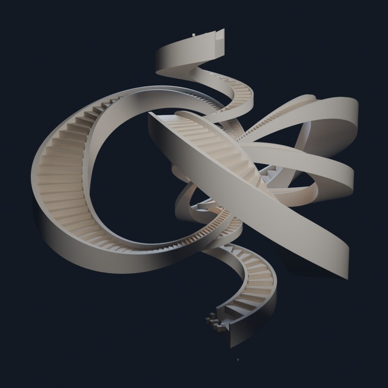
  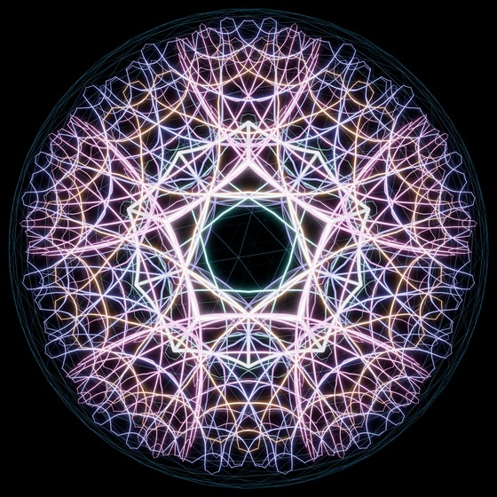
  
  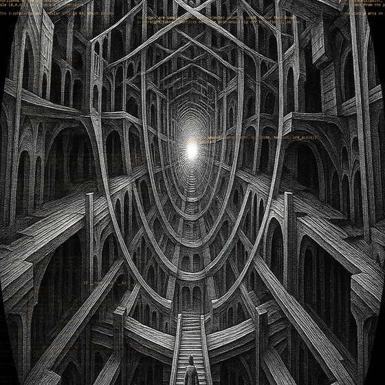

<h3 align="center">Randall Morgan</h3>

  <b>Design engineer.</b> I build and ship products solo, AI-assisted. 
  Desktop apps &middot; browser tools &middot; 3D software &middot; every one of these is live and paid for

  <a href="https://pardesco.com">pardesco.com</a> &nbsp;·&nbsp;
  <a href="https://laserburnai.com">laserburnai.com</a> &nbsp;·&nbsp;
  <a href="https://x.com/pardesco_">@pardesco_</a>

---

<!-- rows:start (generated by scripts/build-rows.mjs) -->
### Shipped

  <a href="https://github.com/Pardesco/hypernovum">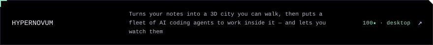</a>
  <a href="https://superhivemarket.com/products/reshoot">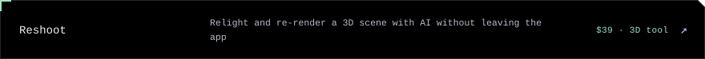</a>
  <a href="https://pardesco.com/products/4d-polytope-engine">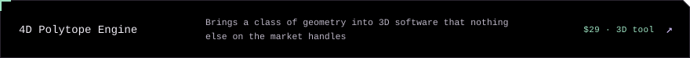</a>
  <a href="https://superhivemarket.com/products/vessellab">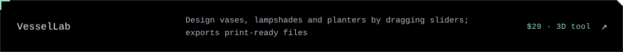</a>
  <a href="https://laserburnai.com/tools/ornament-studio">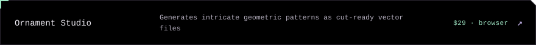</a>
  <a href="https://laserburnai.com/tools">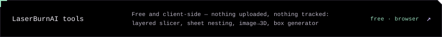</a>

### Open source

  <a href="https://github.com/Pardesco/algorithmic-art-skill">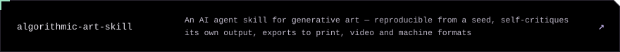</a>
  <a href="https://github.com/Pardesco/claude-codex-review-skill">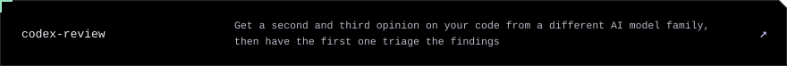</a>
  <a href="https://github.com/Pardesco/claude-agy-bug-search-skill">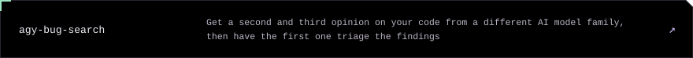</a>
  <a href="https://github.com/Pardesco/4d-polytope-viewer">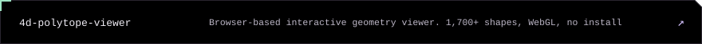</a>
  <a href="https://github.com/Pardesco/envelope-extrusion-explorer">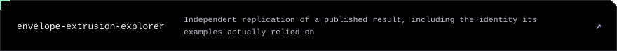</a>

<!-- rows:end -->

### Stack & tools

  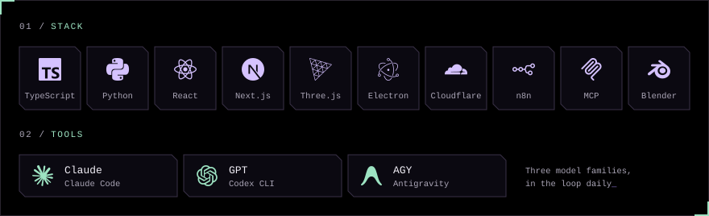

TypeScript · Python · React + Three.js / WebGL · Cloudflare Workers &amp; Pages · Electron · Blender Python API · Claude Code, Codex and Antigravity in the loop daily

---

  

Most of what I build lives in private repos — the graph above is a fraction of it.

